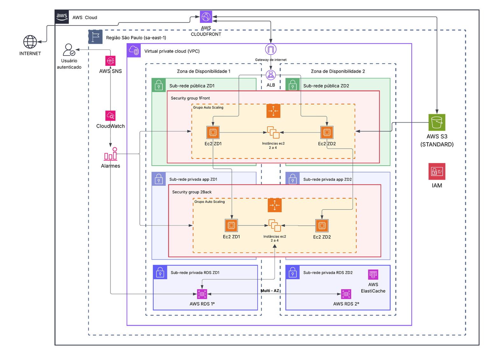

<p align="center">
  
</p>

# Modernização de um Marketplace com Arquitetura AWS

> Uma proposta escalável, segura e preparada para crescer.

Projeto de conclusão do **AWS re/Start** da **Generation Brasil** — **Grupo 3 · 2026**.

## Sobre o projeto

A **VarejoJá** é um marketplace que roda em uma infraestrutura legada. Ela trava nos picos de acesso (como a Black Friday), pode sair do ar se um componente centralizado falhar, guarda fotos e vídeos em disco local e depende de backups mensais manuais.

Nossa proposta leva a VarejoJá para a **nuvem AWS**, na região de **São Paulo (sa-east-1)**, com uma arquitetura que cresce sob demanda, continua no ar mesmo se uma zona falhar e faz backups automáticos.

## Arquitetura proposta



| Camada | Serviços | Problema que resolve |
|---|---|---|
| Computação | EC2 + Auto Scaling | Picos de acesso: liga mais servidores quando o movimento sobe |
| Rede e distribuição | VPC + ALB + CloudFront | Reparte os clientes e entrega fotos e vídeos rápido |
| Dados e armazenamento | RDS Multi-AZ + ElastiCache + S3 | Banco que não para, consultas rápidas e mídias sem limite de espaço |
| Backup e recuperação | RDS Backups + S3 Versioning | Recupera dados em caso de falha ou exclusão acidental |
| Segurança e observabilidade | IAM + Security Groups + CloudWatch + SNS | Só entra quem tem permissão, e a equipe é avisada se algo sair do normal |

## Estratégia de migração

| Origem (data center legado) | Destino (AWS) | Ferramenta |
|---|---|---|
| Aplicação da loja (back end e front end) | Amazon EC2 | Reimplantação |
| Banco de dados legado | Amazon RDS | AWS DMS |
| Imagens e vídeos | Amazon S3 | AWS DataSync |

## Custos (resumo)

Estimativa para a região de São Paulo, sob demanda, em US$ por mês.

| | Mês normal | Semana de pico (Black Friday) |
|---|---|---|
| Total estimado | ≈ US$ 4.921,35 | ≈ US$ 5.896,07 (+20%) |

Com o Auto Scaling, a economia nos servidores no mês de pico é de cerca de **US$ 3.260,65 (≈ 40%)**, comparado a manter 8 servidores ligados o mês todo. Detalhes e premissas em [`docs/custos.md`](docs/custos.md).

## Datas sazonais e escala

Em um cenário ilustrativo (1 instância ≈ 1.000 acessos simultâneos), um dia comum tem cerca de 2.000 acessos simultâneos, enquanto Black Friday e Natal chegam a 10–12 mil. O Auto Scaling vai de 4 até 8 instâncias EC2 no pico e volta ao mínimo depois, reduzindo o custo. Mais em [`docs/sazonalidade-e-evolucao.md`](docs/sazonalidade-e-evolucao.md).

## Próximos passos

Plano de recuperação de desastres (DR), infraestrutura como código (CloudFormation/Terraform), pipelines de CI/CD e gestão de custos (FinOps e AWS Budgets).

## Estrutura do repositório

```
VarejoJa-AWS/
├── README.md
├── apresentacao/      # Slides finais do projeto (.pptx)
├── arquitetura/       # Diagrama da arquitetura AWS
├── docs/              # Detalhamento: custos, migração e evolução
└── assets/            # Logo e imagens do README
```

## Equipe — Grupo 3

| Integrante | Papel no projeto | LinkedIn |
|---|---|---|
| Ingrid | Liderança ágil | [adicionar link](https://www.linkedin.com/in/ingridpereira1/) |
| Jamilly | Estratégia de migração | [adicionar link](https://www.linkedin.com/in/005jamilly/) |
| Guilherme | Jornada e documentação | [adicionar link](https://www.linkedin.com/in/guilhermoreiraa/) |
| Bruno | Seleção de serviços AWS | [adicionar link](https://www.linkedin.com/in/bruno-otto-cavalcante-vieira/) |
| Marjorie | Diagrama de arquitetura | [adicionar link](https://www.linkedin.com/in/marjoriejds/) |
| Paulo | Estimativa de custos | [adicionar link](https://www.linkedin.com/in/pauloalmeidapinto/) |
| Erick | Capacidade e escala | [adicionar link](https://www.linkedin.com/in/alexandrerick/) |

---

AWS re/Start · Generation Brasil · 2026
